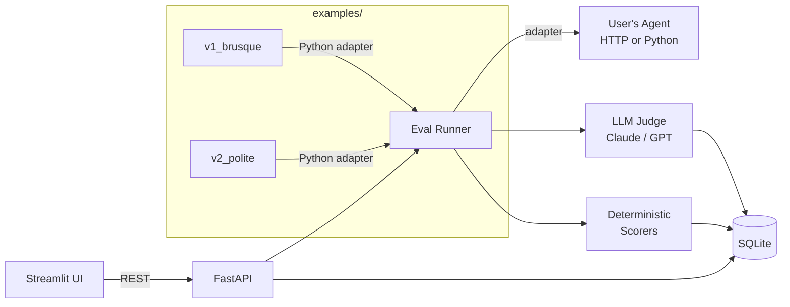

# Architecture

## Overview

Agent Eval Lab is a self-hosted evaluation harness. A FastAPI backend orchestrates eval runs; a Streamlit UI consumes the REST API; SQLite stores everything. The critical abstraction is the **adapter/runner/scorer split** — the runner never imports agent code directly, and scorers are interchangeable plugins.



---

## Package layout

```
src/agent_eval_lab/
  models.py       — SQLModel entities: Suite, EvalCase, Rubric, AgentVersion,
                    Run, CaseResult, Score
  db.py           — engine init, session factory, create_all (run directly to
                    create the schema)
  schemas.py      — Pydantic request/response shapes used by FastAPI; keeps
                    API contracts separate from DB models
  adapters.py     — Adapter protocol + HTTPAdapter + PythonAdapter; the only
                    file that knows how to call an external agent
  runner.py       — execute_run() orchestration loop; iterates suite cases,
                    calls adapter, dispatches scorers, persists results
  scorers.py      — JudgeScorer (LLM-as-judge via Claude) + DeterministicScorer
                    (regex / json_schema / tool_call_sequence)
  api.py          — FastAPI app, routers for /suites /rubrics /agents /runs,
                    BackgroundTasks wiring for async run execution
  cli.py          — Typer CLI entry point (agent-eval run …); delegates to
                    runner.execute_run()
  ui.py           — Streamlit pages: sidebar nav, dataset browser, run launcher,
                    live progress bar, Plotly heatmap, trace drawer, compare view
```

---

## Key design decisions

### 1. Adapter pattern

`runner.py` accepts any object that satisfies the `Adapter` protocol (two methods: `__init__` and `__call__`). This means:

- The runner never imports agent code; it only calls the adapter.
- Swapping from HTTP to in-process Python is a config change, not a code change.
- Adding a new transport (gRPC, subprocess stdin/stdout) is one new class in `adapters.py`.

### 2. Scorer-as-plugin

`JudgeScorer` and `DeterministicScorer` both produce a `Score` row (criterion, value 1–5, reasoning). The runner dispatches to scorers via a dict keyed on `scorer_type`. Adding a third scorer type is one new class in `scorers.py` plus one dict entry in `runner.py`.

### 3. Background execution

`POST /runs` returns a run ID immediately. `execute_run()` runs inside FastAPI `BackgroundTasks`, updating `run.status` as it progresses (`pending → running → completed/failed`). The UI polls `GET /runs/{id}` every 2 seconds and renders whatever scores are already in the DB — so the heatmap fills in incrementally.

### 4. SQLite + files

This is intentional. The entire eval history lives in a single `agent_eval.db` file that can be committed alongside the agent repo. No infrastructure to spin up, no migrations needed for a portfolio demo. If you need horizontal scale, the adapter/runner split is designed to be extracted into a task queue.

### 5. Pydantic boundary

Adapters return `AgentOutput` (Pydantic model). The DB layer uses SQLModel. The Streamlit UI consumes JSON from the FastAPI endpoints only — it never imports SQLModel models directly. This keeps each layer independently testable.

---

## Data flow for one eval run

1. **UI** sends `POST /runs` with `{suite_id, rubric_id, agent_version_id}`.
2. **API** creates a `Run` row with `status=pending`, enqueues `execute_run(run_id)` via `BackgroundTasks`, and returns `{id, status}`.
3. **Runner** (`execute_run`) fetches the suite's `EvalCase` rows and the `AgentVersion` config, then constructs the appropriate adapter (`HTTPAdapter` or `PythonAdapter`).
4. For each case, the runner calls `adapter(case.input_json)` → receives `AgentOutput`.
5. A `CaseResult` row is written with the raw output, trace, latency, and token count.
6. For each rubric criterion the runner dispatches to the correct scorer:
   - `llm_judge` → `JudgeScorer.score()` calls Claude with a structured prompt.
   - `deterministic` → `DeterministicScorer.score()` runs regex / schema / sequence checks.
7. Each scorer returns a `Score(criterion, value, reasoning)` which is written to the DB.
8. After all cases complete, the runner sets `run.status = completed`.
9. **UI** detects `status=completed`, fetches all `Score` rows for the run, and renders the Plotly heatmap.
