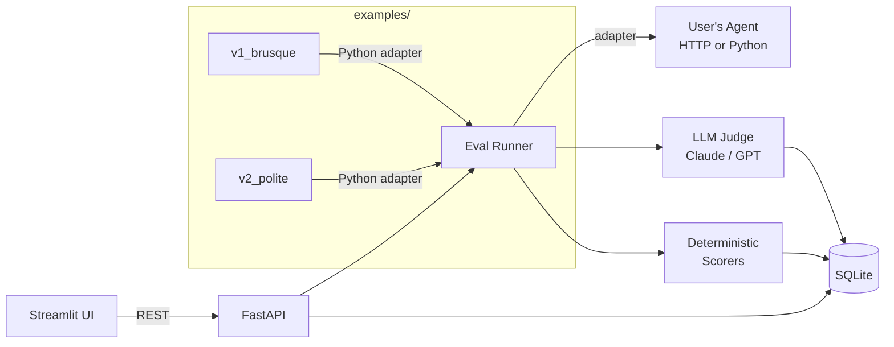

# Agent Eval Lab


> Self-hosted, UI-first evaluation harness for AI agents.
> Point it at any agent, define rubrics as YAML, and get LLM-as-judge + deterministic scores in one command.
> Compare two agent versions with a delta heatmap — find regressions before they reach production.


---

## Why this exists

Most agent repos ship with vibes-based eval: "it worked when I tried it." In production, the hard problem is: *did my prompt change regress customer-support politeness? Did my new retrieval tool make the agent hallucinate more?*

Agent Eval Lab gives you the smallest useful loop around that question — datasets, rubrics, runs, scores, diffs — without forcing you onto a paid SaaS or a 50-service observability stack.

---

## Quickstart

```bash
git clone https://github.com/your-org/agent-eval-lab && cd agent-eval-lab
export ANTHROPIC_API_KEY=sk-...
make demo     # seeds DB, starts API (port 8000) + Streamlit UI (port 8501)
```

Then open [http://localhost:8501](http://localhost:8501).

For development:

```bash
make dev          # install dev deps + pre-commit hooks
make test         # pytest
make lint         # ruff check + autofix
make typecheck    # mypy strict
```

To use the bundled LangGraph example agents:

```bash
pip install -e ".[examples]"
```

---

## Demo flow

1. Clone the repo, run `make demo`. A sample agent (a tiny LangGraph customer-support bot) and the eval UI both come up.
2. In the UI open the `customer_support` suite — 20 test cases, 4 rubric criteria (helpful, correct, polite, concise).
3. Hit **Run**. A progress bar fills; each test case gets executed against the agent, then scored by Claude-as-judge.
4. A heatmap appears: rows=cases, columns=criteria, colored by score.
5. Tweak the agent's system prompt, run again. The **Compare** tab shows v1 vs v2 side-by-side with deltas: *politeness +0.4, conciseness -0.2*.
6. Click a regressed case to see the full trace and judge's reasoning.


---

## Features

- **Datasets** — define test cases (input, expected behavior, optional ground truth) as YAML
- **Rubrics as YAML** — criteria + 1–5 scoring guidance per criterion; version-control your eval criteria
- **LLM-as-judge scorer** — calls Claude (configurable via `JUDGE_MODEL`) with a structured rubric prompt; returns score 1–5 + reasoning
- **Deterministic scorers** — regex match, JSON schema validation, tool-call-sequence assertions
- **Parallel scoring** — criteria scored concurrently via `ThreadPoolExecutor`
- **HTTP + Python adapters** — point at any `POST /chat` endpoint or a `module:callable` in-process
- **Streamlit UI** — dataset browser, rubric editor, run launcher, live progress bar, Plotly score heatmap
- **Trace drawer** — inspect agent turns, tool calls, latency, token stats, and per-criterion judge reasoning
- **A/B compare view** — diverging delta heatmap + side-by-side trace inspector for regressed cases
- **SQLite persistence** — entire eval history is a single file you can commit alongside your agent

---

## Architecture



→ See [ARCHITECTURE.md](ARCHITECTURE.md) for a full walkthrough of the package layout and key design decisions.

---

## Roadmap

- [x] M1 — scaffold + readme
- [x] M2 — data model (SQLModel + SQLite persistence + seed data)
- [x] M3 — FastAPI backend + agent adapters (HTTP + Python callable) + CLI runner
- [x] M4 — LLM-as-judge (Claude) + deterministic scorers (regex, JSON schema, tool-call sequence); parallel scoring wired into runner
- [x] M5 — Streamlit UI: dataset browser, run launcher with live progress bar, Plotly score heatmap
- [x] M6 — trace drawer + A/B compare view
- [x] M7 — example LangGraph agent (v1 brusque / v2 polite); `customer_support` suite (20 cases); `json_extraction` suite (15 cases, deterministic); pluggable-agent docs
- [x] M8 — demo GIF (`docs/demo.gif`), compare-view screenshot (`docs/screenshot.png`), VHS tape + `record_demo.sh`, `make record` target, smoke test; `make demo` verified on a fresh clone with only `ANTHROPIC_API_KEY`
- [x] M9 — polish: readme + architecture + roadmap

### Future work

- [ ] CI integration — GitHub Actions workflow that runs `agent-eval run` on every PR and posts score deltas as a PR comment
- [ ] Cost tracking — record token usage + estimated USD per run; surface total cost in the heatmap tooltip
- [ ] Pairwise judging — present judge with two agent outputs simultaneously; Bradley-Terry ranking from pair comparisons
- [ ] OpenTelemetry export — emit run/case/score spans to any OTLP collector (Jaeger, Grafana Tempo) for trace correlation

---

→ See [CONTRIBUTING.md](CONTRIBUTING.md) for how to add new adapters and scorers.

---

## License

MIT — see [LICENSE](LICENSE).
