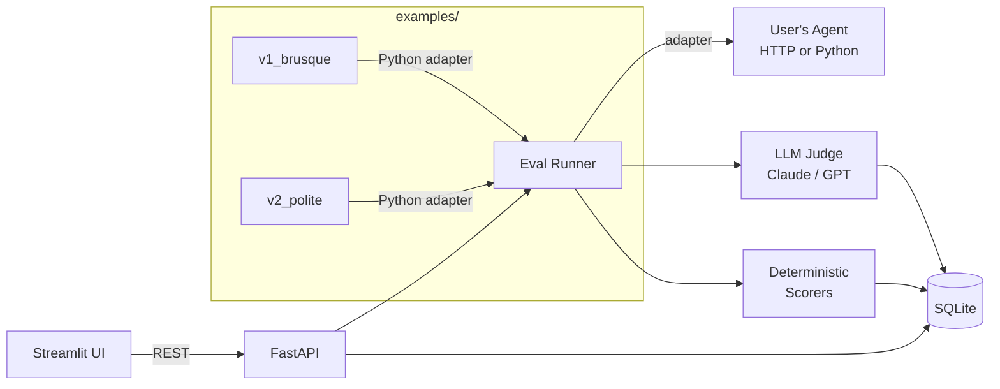

# Agent Eval Lab

> Self-hosted, UI-first evaluation harness for AI agents.


Point it at any agent (HTTP endpoint or Python callable), define test cases and rubrics, and get rubric-based scores from an LLM-as-judge plus deterministic checks (regex, JSON schema, tool-call assertions). Browse runs, inspect per-turn traces, and compare two agent versions side-by-side.

---

## Why this exists

Most agent repos ship with vibes-based eval: "it worked when I tried it." In production, the hard problem is: *did my prompt change regress customer-support politeness? Did my new retrieval tool make the agent hallucinate more?*

Agent Eval Lab gives you the smallest useful loop around that question — datasets, rubrics, runs, scores, diffs — without forcing you onto a paid SaaS or a 50-service observability stack.

---

## Demo flow

1. Clone the repo, run `make demo`. A sample agent (a tiny LangGraph customer-support bot) and the eval UI both come up.
2. In the UI open the `customer_support` suite — 20 test cases, 4 rubric criteria (helpful, correct, polite, concise).
3. Hit **Run**. A progress bar fills; each test case gets executed against the agent, then scored by Claude-as-judge.
4. A heatmap appears: rows=cases, columns=criteria, colored by score.
5. Tweak the agent's system prompt, run again. The **Compare** tab shows v1 vs v2 side-by-side with deltas: *politeness +0.4, conciseness -0.2*.
6. Click a regressed case to see the full trace and judge's reasoning.

---

## What works now (M7)

| Item | Status |
|---|---|
| `src/agent_eval_lab/` package layout | done |
| `pyproject.toml` — hatchling build, Python 3.11+ | done |
| Linting: `make lint` (ruff, line-length 100) | done |
| Type checking: `make typecheck` (mypy strict) | done |
| Tests: `make test` (pytest + pytest-asyncio) | done |
| Pre-commit hooks (ruff + mypy on commit) | done |
| CLI entry point (`agent-eval run --suite … --agent … --rubric …`) | done |
| MIT license | done |
| `make demo` — starts API (port 8000) + Streamlit UI (port 8501) | **done** |
| **SQLModel data model** (Suite, EvalCase, Rubric, AgentVersion, Run, CaseResult, Score) | **done** |
| **SQLite persistence** via `SQLModel.metadata.create_all` | **done** |
| **Seed script** — loads both sample suites + both agent versions from YAML (idempotent) | **done** |
| **FastAPI backend** — `/suites`, `/rubrics`, `/agents`, `/runs` CRUD endpoints | **done** |
| **AgentOutput schema** (Pydantic) — normalised turns, tool calls, final response, latency, token count | **done** |
| **Pydantic API schemas** — typed request bodies and response shapes for all endpoints | **done** |
| **HTTPAdapter** — POST JSON to any HTTP agent endpoint; tolerates `response`, `message`, or turns shapes | **done** |
| **PythonAdapter** — dynamically imports a `module:callable` and calls it in-process | **done** |
| **Eval runner** — `execute_run()` iterates suite cases, calls adapter, persists `CaseResult` + `Score` rows | **done** |
| **LLM-as-judge scorer** — calls Claude (configurable via `JUDGE_MODEL` env var) with structured rubric prompt, returns 1–5 score + reasoning | **done** |
| **Deterministic scorers** — `regex` (pattern or `expected.contains`), `json_schema` (jsonschema validation), `tool_call_sequence` (subsequence check) | **done** |
| **Parallel scoring** — criteria scored concurrently via `ThreadPoolExecutor`; DB writes stay on main thread | **done** |
| **Streamlit UI** — sidebar nav (Suites / Rubrics / Agents / Runs), dataset browser, Launch Run form | **done** |
| **Live progress bar** — polls `GET /runs/{id}` every 2 s while a run executes | **done** |
| **Plotly heatmap** — rows = case IDs, columns = rubric criteria, colour = score 1–5 (RdYlGn) | **done** |
| **Background execution** — `POST /runs` fires `execute_run` via FastAPI `BackgroundTasks` | **done** |
| **Trace drawer** — select any case from the heatmap to inspect agent turns, tool calls, latency/token stats, and per-criterion scores + judge reasoning | **done** |
| **Compare page** — pick two runs, view a diverging delta heatmap (RdYlGn, red = regression), side-by-side trace inspector for any case | **done** |
| **`examples/` — LangGraph customer-support agent** in two versions: `v1_brusque` (terse) and `v2_polite` (empathetic), wired as Python-callable agents | **done** |
| **`customer_support` suite** — 20 cases (shipping, refunds, escalations, account issues, product FAQ), rubric: helpful / correct / polite / concise | **done** |
| **`json_extraction` suite** — 15 cases (invoices, tickets, contracts, medical, logistics…), scored deterministically via JSON-schema validation | **done** |
| **Pluggable agent docs** — `examples/README.md` documents HTTP and Python adapter contracts with copy-paste registration snippets | **done** |

### Run the API

```bash
uvicorn agent_eval_lab.api:app --reload
# → http://localhost:8000/docs
```

### Run the Streamlit UI

```bash
make ui
# → http://localhost:8501
```

Or start both together:

```bash
make demo
```

### Init DB + seed

```bash
# Create tables
python -m agent_eval_lab.db

# Populate with sample data (idempotent):
# registers customer_support_v1 / customer_support_v2,
# customer_support suite (20 cases), json_extraction suite (15 cases)
python scripts/seed.py
```

### Run an eval from the CLI

```bash
agent-eval run --suite customer_support --agent my_agent --rubric customer_support_rubric
```

---

## Quickstart

```bash
git clone https://github.com/your-org/agent-eval-lab && cd agent-eval-lab
make dev      # install dev deps + install pre-commit hooks
make test     # run the test suite
make lint     # lint + autofix with ruff
make typecheck  # mypy strict check
```

To use the bundled LangGraph example agents, install the optional extra:

```bash
pip install -e ".[examples]"
export ANTHROPIC_API_KEY=sk-...
```

`make demo` starts both the FastAPI server (port 8000) and the Streamlit UI (port 8501).

---

## Architecture (M1–M7 implemented)



---

## Roadmap

- [x] M1 — scaffold + readme
- [x] M2 — data model (SQLModel + SQLite persistence + seed data)
- [x] M3 — FastAPI backend + agent adapters (HTTP + Python callable) + CLI runner
- [x] M4 — LLM-as-judge (Claude) + deterministic scorers (regex, JSON schema, tool-call sequence); parallel scoring wired into runner
- [x] M5 — Streamlit UI: dataset browser, run launcher with live progress bar, Plotly score heatmap
- [x] M6 — trace drawer + A/B compare view
- [x] M7 — example LangGraph agent (v1 brusque / v2 polite); `customer_support` suite (20 cases); `json_extraction` suite (15 cases, deterministic); pluggable-agent docs

---

## License

MIT — see [LICENSE](LICENSE).
