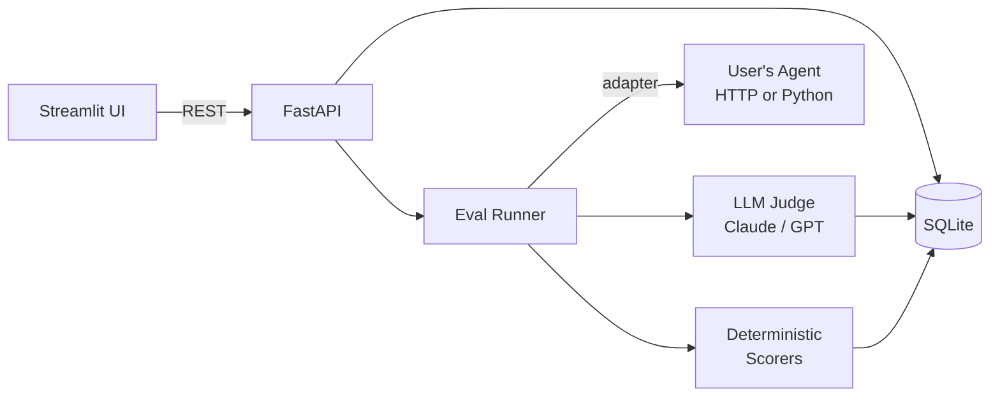

# Agent Eval Lab

> Self-hosted, UI-first evaluation harness for AI agents.


Point it at any agent (HTTP endpoint or Python callable), define test cases and rubrics, and get rubric-based scores from an LLM-as-judge plus deterministic checks (regex, JSON schema, tool-call assertions). Browse runs, inspect per-turn traces, and compare two agent versions side-by-side.

---

## Why this exists

Most agent repos ship with vibes-based eval: "it worked when I tried it." In production, the hard problem is: *did my prompt change regress customer-support politeness? Did my new retrieval tool make the agent hallucinate more?*

Agent Eval Lab gives you the smallest useful loop around that question — datasets, rubrics, runs, scores, diffs — without forcing you onto a paid SaaS or a 50-service observability stack.

---

## Demo flow

1. Clone the repo, run `make demo`. A sample agent (a tiny LangGraph customer-support bot) and the eval UI both come up.
2. In the UI open the `customer_support` suite — 20 test cases, 4 rubric criteria (helpful, correct, polite, concise).
3. Hit **Run**. A progress bar fills; each test case gets executed against the agent, then scored by Claude-as-judge.
4. A heatmap appears: rows=cases, columns=criteria, colored by score.
5. Tweak the agent's system prompt, run again. The **Compare** tab shows v1 vs v2 side-by-side with deltas: *politeness +0.4, conciseness -0.2*.
6. Click a regressed case to see the full trace and judge's reasoning.

---

## What works now (M3)

| Item | Status |
|---|---|
| `src/agent_eval_lab/` package layout | done |
| `pyproject.toml` — hatchling build, Python 3.11+ | done |
| Linting: `make lint` (ruff, line-length 100) | done |
| Type checking: `make typecheck` (mypy strict) | done |
| Tests: `make test` (pytest + pytest-asyncio) | done |
| Pre-commit hooks (ruff + mypy on commit) | done |
| CLI entry point (`agent-eval run --suite … --agent … --rubric …`) | done |
| MIT license | done |
| `make demo` | prints "Demo coming in M7" |
| **SQLModel data model** (Suite, EvalCase, Rubric, AgentVersion, Run, CaseResult, Score) | **done** |
| **SQLite persistence** via `SQLModel.metadata.create_all` | **done** |
| **Seed script** — loads `customer_support` suite (5 cases) + rubric (4 criteria) from YAML | **done** |
| **FastAPI backend** — `/suites`, `/rubrics`, `/agents`, `/runs` CRUD endpoints | **done** |
| **AgentOutput schema** (Pydantic) — normalised turns, tool calls, final response, latency, token count | **done** |
| **Pydantic API schemas** — typed request bodies and response shapes for all endpoints | **done** |
| **HTTPAdapter** — POST JSON to any HTTP agent endpoint; tolerates `response`, `message`, or turns shapes | **done** |
| **PythonAdapter** — dynamically imports a `module:callable` and calls it in-process | **done** |
| **Eval runner** — `execute_run()` iterates suite cases, calls adapter, persists `CaseResult`; scoring deferred to M4 | **done** |

### Run the API

```bash
uvicorn agent_eval_lab.api:app --reload
# → http://localhost:8000/docs
```

### Init DB + seed

```bash
# Create tables
python -m agent_eval_lab.db

# Populate with sample data (idempotent)
python scripts/seed.py
```

### Run an eval from the CLI

```bash
agent-eval run --suite customer_support --agent my_agent --rubric customer_support_rubric
```

---

## Quickstart

```bash
git clone https://github.com/your-org/agent-eval-lab && cd agent-eval-lab
make dev      # install dev deps + install pre-commit hooks
make test     # run the test suite
make lint     # lint + autofix with ruff
make typecheck  # mypy strict check
```

`make demo` is a no-op until M7 (Streamlit UI).

---

## Architecture (M1–M3 implemented; M4–M9 planned)



---

## Roadmap

- [x] M1 — scaffold + readme
- [x] M2 — data model (SQLModel + SQLite persistence + seed data)
- [x] M3 — FastAPI backend + agent adapters (HTTP + Python callable) + CLI runner
- [ ] M4 — deterministic scorers (regex, JSON schema, tool-call sequence)
- [ ] M5 — LLM-as-judge scorer (Claude + GPT)
- [ ] M6 — (merged into M3)
- [ ] M7 — Streamlit UI (dataset browser, run launcher, heatmap)
- [ ] M8 — A/B diff view + trace drawer
- [ ] M9 — demo suite (customer-support bot + 20 test cases)

---

## License

MIT — see [LICENSE](LICENSE).
