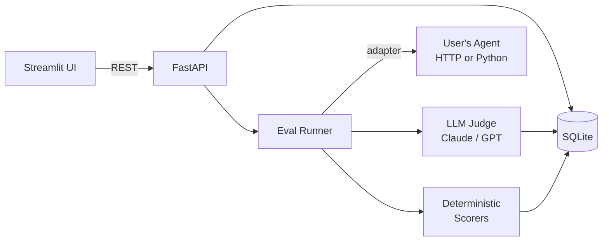

# Agent Eval Lab

> Rubric-based, LLM-as-judge evaluation harness for AI agents with a web UI for test suites, scoring, and side-by-side version comparison.

<!-- TODO: replace with a 5-10 second demo gif. Record with ScreenToGif on
     Windows or peek on macOS. Save to docs/demo.gif and update path here. -->


## What it is

Agent Eval Lab is a self-hosted eval harness for AI agents. You point it at any agent — an HTTP endpoint or a Python callable — define test cases and rubrics as YAML, and get scores from an LLM-as-judge (Claude or GPT) plus deterministic checks (regex, JSON schema, tool-call sequence assertions). Every run is stored in SQLite so results are reproducible and versionable alongside your code.

The web UI is the main interface. It lets you browse datasets, launch runs with a live progress bar, inspect a score heatmap across all test cases and criteria, drill into per-turn traces, and compare two agent versions side-by-side on a diverging delta heatmap. The point is to answer one question fast: did my last change make things better or worse?

## Quickstart

```bash
git clone https://github.com/RitikPatill/agent-eval-lab.git
cd agent-eval-lab
export ANTHROPIC_API_KEY=sk-...
make demo     # seeds DB, starts API (port 8000) + Streamlit UI (port 8501)
```

Then open [http://localhost:8501](http://localhost:8501).

For development:

```bash
make dev          # install dev deps + pre-commit hooks
make test         # pytest
make lint         # ruff check + autofix
make typecheck    # mypy strict
```

## Usage

`make demo` starts the bundled LangGraph customer-support example agent alongside the UI. Once both are running:

1. Open the `customer_support` suite — 20 test cases, 4 rubric criteria (helpful, correct, polite, concise).
2. Click **Run**. Each case is sent to the agent, then scored by Claude-as-judge. A heatmap fills in as results arrive.
3. Tweak the agent's system prompt (edit `examples/agents/v2_polite.py`), register it, and run again.
4. Switch to the **Compare** tab to see v1 vs v2 side-by-side with per-criterion deltas: *politeness +0.4, conciseness -0.2*.
5. Click any regressed case to read the full trace and the judge's reasoning.

To run a suite from the CLI without the UI:

```bash
agent-eval run --suite customer_support --rubric customer_support_v1 --agent v1_brusque
```

To hit your own agent over HTTP, register an `AgentVersion` with `adapter_type=http` and `config_json={"url": "http://localhost:8000/chat"}`.

## Architecture



See [ARCHITECTURE.md](ARCHITECTURE.md) for a full walkthrough of the package layout and key design decisions.

## Project structure

```
src/agent_eval_lab/   core package (models, runner, scorers, adapters, API, CLI, UI)
data/                 bundled YAML suites and rubrics
examples/agents/      LangGraph example agents (v1 brusque, v2 polite)
scripts/              seed.py — populates SQLite from data/ on first run
tests/                pytest suite (unit + smoke)
docs/                 demo.gif, screenshot.png, VHS tape
Makefile              dev, test, lint, typecheck, demo, record targets
```

## Roadmap

- [ ] CI integration — GitHub Actions workflow that runs `agent-eval run` on every PR and posts score deltas as a PR comment
- [ ] Cost tracking — record token usage and estimated USD per run; surface totals in the heatmap tooltip
- [ ] Pairwise judging — present the judge with two outputs simultaneously; derive rankings via Bradley-Terry
- [ ] OpenTelemetry export — emit run/case/score spans to any OTLP collector for trace correlation
- [ ] Async runner — concurrent case execution to reduce wall-clock time on large suites

## License

MIT — see [LICENSE](LICENSE).

---

Built autonomously by [autodev](https://github.com/RitikPatill/autodev),
a multi-agent orchestrator I designed. Each commit in this repo was
authored by me; the implementation work was performed by Sonnet under
the orchestrator's control. Read the orchestrator's README to see how.
